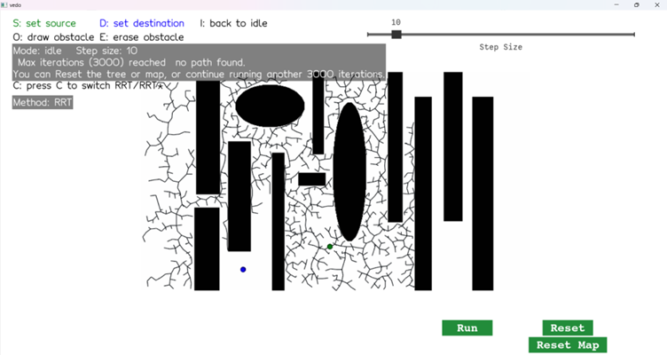
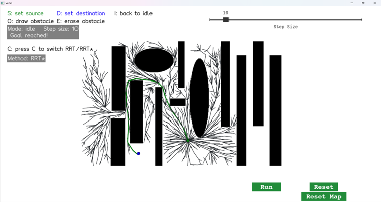
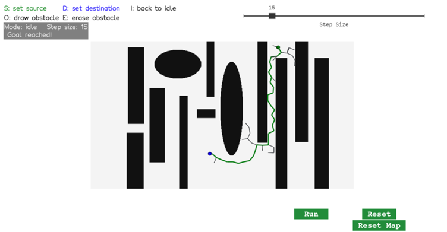

# Robot Path Planning with RRT and RRT*

An interactive path planner in **Python** that finds a collision-free route for a robot from a start point to a goal on a 2D obstacle map. It implements the **RRT** (Rapidly-exploring Random Tree) algorithm and its optimized variant **RRT\***, with a hands-on GUI for drawing obstacles and watching the search unfold in real time.

Built for the **Introduction to Animation and Robotics** course at the University of Haifa (2025).

  
  
   
  <em>Same map, same 3,000-iteration budget: classic RRT (left) is still searching, while RRT* (right) has found a path.</em>

## Features

**Algorithms**
- **RRT:** samples random points, steers a fixed step toward each one from the nearest tree node (KD-tree search), and grows the tree until it reaches the goal
- **Collision detection:** Bresenham's line algorithm checks every pixel along each new edge against the obstacle map
- **Path extraction:** walks back through parent pointers and highlights the final route
- **RRT\*:** connects each new node to the lowest-cost neighbor within a radius, then *rewires* nearby nodes when the new node offers them a shorter path to the start

**Interactive GUI**
- Set the start (**S**) and goal (**D**) by clicking on the map
- Freehand **draw** (**O**) and **erase** (**E**) obstacles, like a simple paint tool
- Step-size slider, Run / Pause, Reset Tree and Reset Map buttons
- Switch between RRT and RRT\* with **C**
- Live iteration and node counters, plus an animated replay of the final path

## How It Works

  

## Documentation

- [`report.md`](report.md) – full write-up: the code for each step, collision-detection sanity checks, stopping conditions, and an RRT vs. RRT\* comparison
- [`assignment_instructions.md`](assignment_instructions.md) – the original assignment instructions

## Running

    pip install vedo numpy scipy
    python assignment4.py

A window opens with the obstacle map. Place the start and goal points, press **Run**, and watch the tree grow.

## Tech Stack

Python · NumPy · SciPy (KD-tree) · vedo (interactive visualization)

---

Developed by **Hala Ishan** · Introduction to Animation and Robotics, University of Haifa
