# Report for Assignment 4 - Path Planning with RRT

**Name:** Hala Ishan  
**Student ID:** 213692296
---
### **Task 1: Complete the GUI**

---
### 1.1 : Add the ability to set the source and destination points. Add a button to reset the tree. Add a slider to change the step size.

| Requirement                               | Implementation                                                                                 |
|-------------------------------------------|-----------------------------------------------------------------------------------------------|
| Set source & destination points           | Press **S** (green) or **D** (blue), then click free map tiles; invalid clicks show warnings  |
| Reset tree button                         | Clears all RRT nodes & edges but preserves current start/goal markers                         |
| Step‐size slider (1–100)                  | Slider snaps to nearest integer; updates `stepSize` and status box live                       |
| Run/Pause toggle                          | Debounced (0.1 s) start/stop of the timer driving RRT iterations                              |

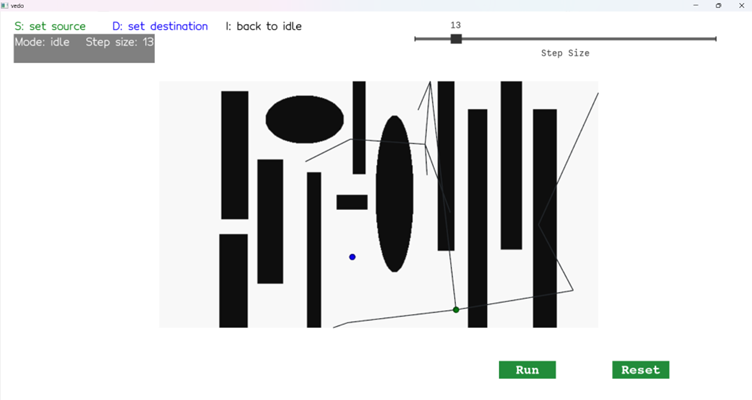

*Interactive GUI with key hints, status box, slider, Run/Pause & Reset buttons.   -    i changed the source and destination point then run it *  


---
###  1.2 : Add a way to change the obstacle map  
Inspired by simple “paint” tools, we built a freehand brush for drawing and erasing obstacles in the RRT map.

| Requirement                       | Implementation                                                                                 |
|-----------------------------------|-----------------------------------------------------------------------------------------------|
| Freehand draw / erase             | **O** toggles draw mode (black brush), **E** toggles erase mode (white brush); move mouse to paint a 5×5 block under the cursor |
| No click-and-drag                 | Brush paints continuously on **mouse move**—just toggle on, sweep over the map, then toggle off |
| Endpoint validation               | Exiting draw mode automatically checks start/dest: if either lies on a newly drawn obstacle, the status box shows “⚠️ Source/Destination on obstacle – press S/D to move” |
| Reset map                         | **Reset Map** button restores the original image and clears all drawn obstacles              |

### Demonstration

[▶ Draw & Erase Obstacles](videos/draw.mkv)  
*Prior to recording, I toggled erase mode and cleared part of an original obstacle, then placed the destination point in that spot—verifying erase functionality. The clip then switches to draw mode to freehand paint new obstacles onto the map.*


 [▶ Reset Map](videos/reset.mkv)  
*The reset video shows restoring the map to its original state. After reset, if the start or destination now lies on an obstacle, the status box warns you to press S/D and move the point.*

---
### 1.3 : Add other means to change the visualization as you see fit
i want to do it after i finished task 2 

---

### **Task 2: Implement RRT**

---

### 2.1 : Complete `getNextSample`

The `getNextSample` function works in three key steps:  
1. Sample a random point in the map.  
2. Find the nearest existing tree node.  
3. “Steer” a fixed distance (`stepSize`) toward it.  

Below is the core of the steering logic:

```python
# inside getNextSample(...)
# 2. Nearest neighbor
sid     = NearestSample(samples, x_rand)
x_near  = np.array(samples[sid].x, dtype=float)

# 3. Compute unit‐direction and step
direction = x_rand - x_near
direction /= np.linalg.norm(direction)          # normalize to unit length
new_pt    = x_near + direction * stepSize      # step exactly stepSize
new_pt    = np.round(new_pt).astype(int)       # snap to integer pixels

return Sample(new_pt, sid)
````

This ensures every new sample lies **exactly** `stepSize` away from its parent, before any collision checks.

---
### 2.2 Implement the Collision function

To determine whether a straight‐line segment between two nodes intersects any obstacles, we:

1. **Enumerate all integer pixels** along the line using Bresenham’s algorithm.  
2. **Convert** each world‐coordinate `(x, y)` (origin at bottom‐left) into image indices `(row, col)` where `row = height - 1 - y`.  
3. **Probe** the obstacle map `img[row, col]` (where `True` = free, `False` = obstacle).  
4. **Return `True`** as soon as any pixel is in an obstacle; otherwise return `False` after checking the entire segment.

```python
def bresenham(x1, y1, x2, y2):
    dx, dy = abs(x2 - x1), abs(y2 - y1)
    x, y = x1, y1
    sx = 1 if x2 > x1 else -1
    sy = 1 if y2 > y1 else -1

    if dx > dy:
        err = dx / 2
        while x != x2:
            yield x, y
            err -= dy
            if err < 0:
                y += sy
                err += dx
            x += sx
        yield x, y
    else:
        err = dy / 2
        while y != y2:
            yield x, y
            err -= dx
            if err < 0:
                x += sx
                err += dy
            y += sy
        yield x, y

def Collision(img, p1, p2):
    """
    Return True if the line segment from p1 to p2 crosses any obstacle.
    - img : 2D boolean array (True=free, False=obstacle), origin at top-left.
    - p1, p2 : (x, y) world coords, origin at bottom-left.
    """
    h, w = img.shape
    for wx, wy in bresenham(p1[0], p1[1], p2[0], p2[1]):
        row = h - 1 - wy
        col = wx
        # out-of-bounds → treat as collision
        if row < 0 or row >= h or col < 0 or col >= w:
            return True
        if not img[row, col]:
            return True
    return False
````


**Explain the code:**

1. **Bresenham’s line generator**  
   - `bresenham(x1, y1, x2, y2)` implements the classic integer‐only algorithm to enumerate every grid cell (pixel) that a straight line from `(x1,y1)` to `(x2,y2)` passes through.  
   - It chooses to step in the dominant direction (x or y) and maintains an error accumulator to know when to step in the other axis.  

2. **World→Image coordinate conversion**  
   - Our RRT points use a “world” origin at the bottom‐left, but the NumPy image array `img` is indexed with row 0 at the top.  
   - Therefore we compute  
     ```python
     row = (height – 1) – world_y  
     col = world_x
     ```  
   - This flips the y-axis so we index the correct pixel in `img[row, col]`.

3. **Collision test loop**  
   ```python
   for wx, wy in bresenham(...):
       …
       if not img[row, col]:
           return True
   return False

* We iterate each pixel on the line.
* If **any** pixel is an obstacle (`img[row, col] == False`), we immediately return `True` (collision detected).
* If the loop completes with no obstacles, we return `False` (the path is clear).

4. **Out-of-bounds as collision**

   * We also treat any pixel outside the valid image bounds as a collision to be safe (e.g. if a sample drifts just off the map).


#### **Sanity Check on the Full Map**

The following screenshots show the RRT growing with collision checking enabled. In both cases the tree **never** penetrates the black obstacles:

- **stepSize = 10**  
  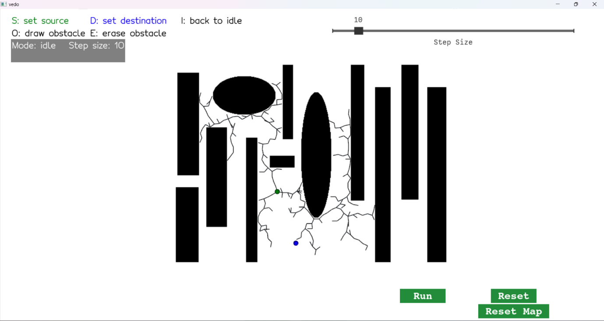  
  *The tree explores up to each obstacle boundary but does not cross it.*

- **stepSize = 15**  
  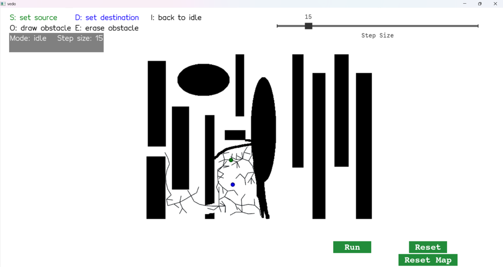  
  *Even with a larger step, no edge crosses the original or newly drawn obstacles, and the tree can grow into areas where I erased obstacles.*  

These confirm that `Collision(img, parent, sample)` correctly rejects any extension into occupied space.
 
---

### 2.3 : Add Stopping Conditions

I enhance `doRRTIteration` with two guards:  

1. **Max‐Iteration Guard**  
   Prevents infinite looping if the goal is unreachable.  
2. **Goal‐Reached Check**  
   Stops as soon as a new node can connect directly to the goal.

```python
def doRRTIteration(event):
    global iteration_count, timer_id

    # 1) Max‐iteration guard
    iteration_count += 1
    if iteration_count > MAX_ITERATIONS:
        update_status("❌ Max iterations reached, no path found")
        plt.timer_callback("destroy", timer_id)
        # return button to "Run" state if needed
        if button.status().strip() == "Pause":
            button.switch()
        return

    # … [sampling, collision‐check, drawing] …

    # 2) Goal‐reached check
    dist_to_goal = np.linalg.norm(ns.x - dest)
    if dist_to_goal <= stepSize and not Collision(img, ns.x, dest):
        # draw final connection
        final_edge = vd.Line(ns.x, dest, lw=3).c('red')
        edges.append(final_edge)
        plt.add(final_edge); plt.render()

        update_status("✅ Goal reached!")
        plt.timer_callback("destroy", timer_id)
        if button.status().strip() == "Pause":
            button.switch()
        return
```

**Reasoning:**

* **Max‐Iteration Guard:** Stops after a fixed number of iterations (`MAX_ITERATIONS = 3,000`) to avoid an endless loop when no path exists.
* **Goal‐Reached Check:**

  * Each new edge moves exactly `stepSize`.
  * Once a node lies within `stepSize` of the goal and the final segment to the goal is obstacle‐free, we know the path is found.
  * We draw the last red edge, halt further iterations, and reset the button for a clear UI state.

---

### Task 2.4 Experiment: RRT Execution Until Goal

I conducted numerous experiments with various `stepSize` values and iteration budgets; in every case the stopping conditions behaved correctly. Below are two representative trials, shown in the order they occur during a typical run:


#### Trial 1 — Goal Reached  
With `stepSize = 10` and `MAX_ITERATIONS = 3000`, the tree eventually grew close enough to the goal. A final red edge marks the successful connection, and the status box updates accordingly.

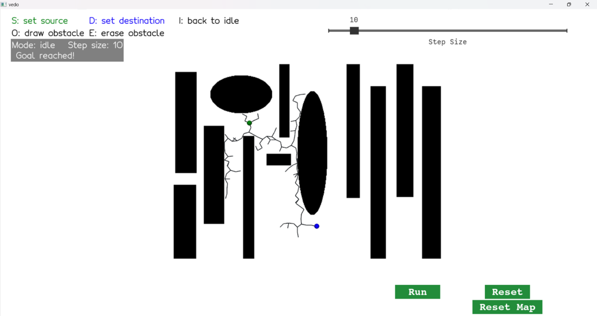

*“✅ Goal reached!” confirms the RRT found a collision-free path and drew the last segment in red.*


#### Trial 2 — Iteration Cap Reached  
In a separate run (or by continuing past the first trial), after 3000 iterations the tree still hadn’t connected to the destination. The timer stopped automatically and the status box displayed a warning. At this point you may choose to reset the tree/map and try again, or simply increase the iteration limit.

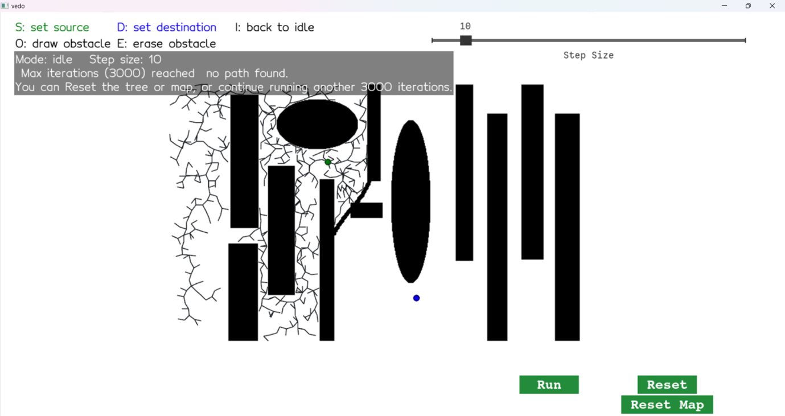

*“❌ Max iterations (3000) reached, no path found…” shows the RRT giving up after exhausting its iteration budget. You can continue running another 3000 iterations or reset and try different parameters.*


**Summary:**  
- The **Goal-Reached Check** halts and highlights the final edge as soon as a valid connection to the goal is found.  
- The **Max-Iteration Guard** prevents infinite looping when the goal is unreachable within the budget, and offers the option to continue or reset.  

---

### 2.5: Extract & Highlight the Final Path

After the RRT discovers a collision-free connection to the goal, we reconstruct the exact route from start → goal and visually distinguish it from the rest of the tree.

**Logic (no code):**

1. **Path reconstruction**

   * Start at the newly added goal‐adjacent node.
   * Follow its `.parent` pointer back through each ancestor until reaching the root (the source).
   * Record each node’s coordinates and then reverse the sequence so it reads from the source all the way to the goal.

2. **Path highlighting**

   * For each consecutive pair of waypoints along this reconstructed path, locate the corresponding tree‐edge in the existing RRT plot.
   * Change that edge’s color to **green** and increase its line thickness—this lets the true “solution path” stand out instantly against the web of exploratory branches.


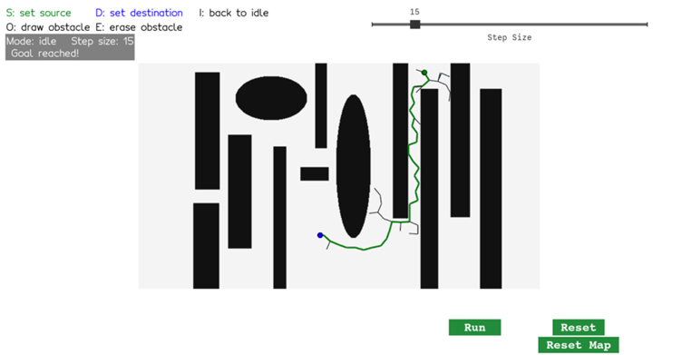

*Once the goal is reached, the exact sequence of edges from the source (green sphere) to the goal (blue sphere) is recolored in bright green and thickened. This clearly delineates the final collision-free path amid the background of all other sampled extensions.*

---

### **Task 3: Implement RRT\***

#### RRT vs. RRT\* Mode Switching

To support both the classic RRT and its optimized variant RRT\* in one GUI, I added:

* A new **Method** label in the corner, showing either **RRT** or **RRT**\*.  
* A keyboard shortcut **C** to toggle between the two modes at any time.  
* When you press **C**, the code:
  1. Flips the global `method` variable between `'rrt'` and `'rrt*'`.  
  2. Calls `reset_tree()` to clear the existing tree (so the new method starts from scratch).  
  3. Updates the on-screen **Method:** label.  


### 3.1: Best-Parent Selection (Connect to Minimum-Cost Neighbor)

In **RRT**\*, instead of always hooking a new sample to its geometrically closest node, we look within a user-defined radius **R** around the sample and choose the neighbor that yields the lowest **cost-to-come** (distance from the start) plus the straight-line cost to the new sample. Concretely:

1. **Compute** the Euclidean distance from the new sample to *every* existing node.
2. **Restrict** to those whose distance ≤ **R** (plus always including the absolute nearest one).
3. **Ignore** any potential parent whose connecting edge collides with an obstacle.
4. **Pick** the node *i* that minimizes

   ```
   cost[i] + dist(i → new_sample)
   ```
5. **Set** `new_sample.parent = i` and `new_sample.cost` accordingly.

The screenshots below shows a tree grown under RRT\* (step size = 10, radius ≈ 30): observe how each new edge (in black) hooks back not to the nearest geometric neighbor, but to whichever node gives the lowest total cost to the start.

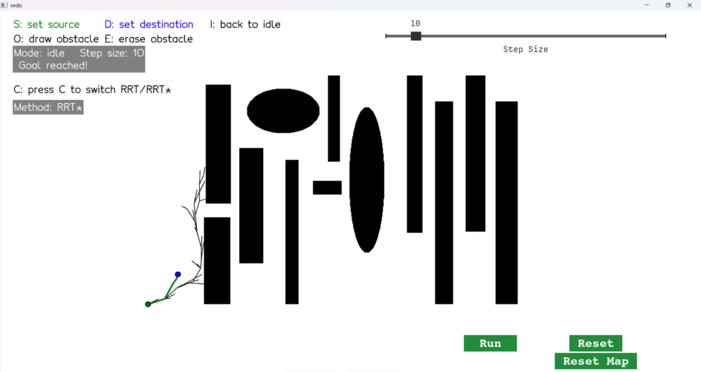  
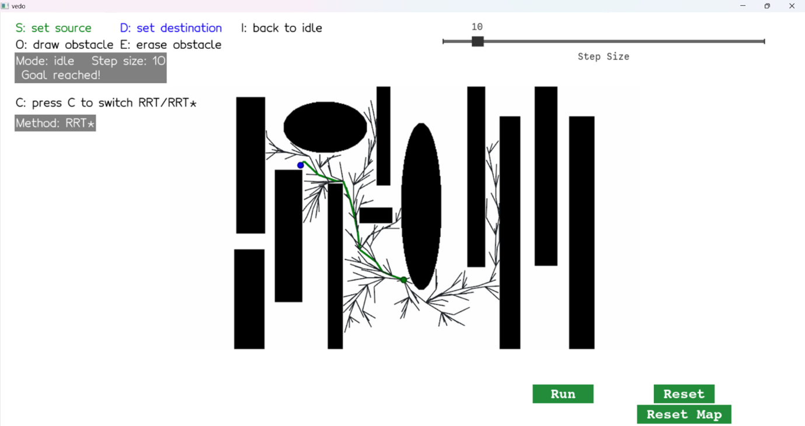  

* In RRT* mode, the green‐highlighted edges connect each new sample to its minimal‐cost parent within the search radius.*  


### 3.2: Local Rewiring (Cost Reduction)

In **RRT\*** mode, after hooking a new sample to its best parent, we **rewire** any existing neighbors within the radius **R** if routing them through the new sample would **lower their cost-to-come**. Concretely:

1. After adding `new_sample`, compute its distance to every other node.
2. For each neighbor `j` with

   ```
   dist(new_sample → samples[j]) ≤ R
   ```

   and whose connecting edge is collision-free, compute

   ```
   cost_via_new = new_sample.cost + dist(new_sample → samples[j])
   ```
3. If `cost_via_new < samples[j].cost`, we remove the old edge, set

   ```python
   samples[j].parent = new_idx
   samples[j].cost   = cost_via_new
   ```

   and draw the new, lower-cost edge.

The screenshot below (in **RRT\*** mode, step size = 10, radius ≈ 30) highlights this process: after each new addition, many nearby branches “snap” over to the fresh node whenever it offers a shorter route back to the start.

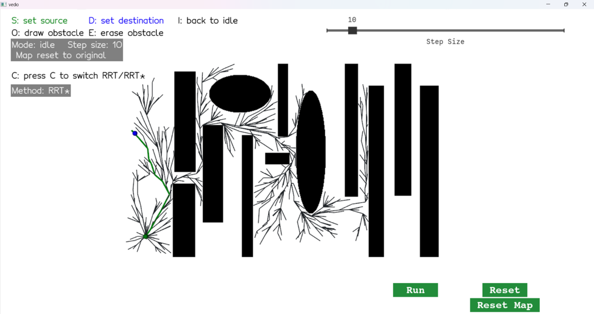

*RRT\* rewiring in action—each green edge marks the final reaching path, while the dozens of small black branches show neighbors that got reattached through the new node for a lower total cost.*

---

#### Comparison: RRT vs. RRT\*

Because classic **RRT** never rewires, every edge remains permanently attached to the very first (nearest-neighbor) parent, even if a much cheaper routing appears later. In contrast, **RRT\*** continually improves the tree’s cost structure via local rewiring.

* **RRT**  
  * Always hooks to the nearest geometric neighbor.  
  * No further adjustments → suboptimal, “ragged” tree shape.  
  * In complex maps, it may exhaust the `MAX_ITERATIONS` budget (3 000) without ever reaching the goal, requiring you to press **Run** again to continue the search.  

* **RRT\***  
  * Hooks to the minimum-cost neighbor within the user-defined radius.  
  * Then rewires all local branches to reduce their cost-to-come → smoother, more direct connectivity.  
  * Converges to the destination far sooner under the same iteration limit.  

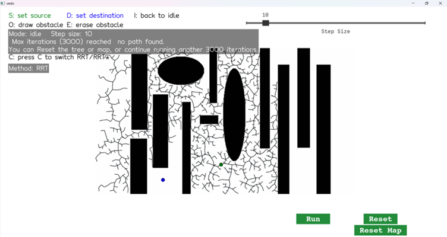 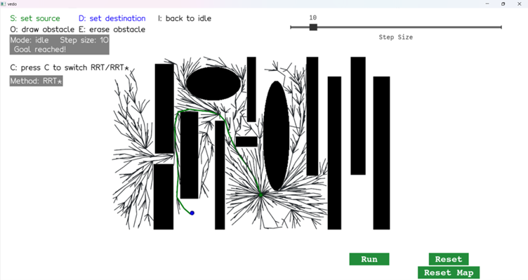  

*Left*: Classic RRT halts after 3 000 iterations with no path found.  
*Right*: RRT\* rewiring yields a valid path (final edge in green) well before the cap.  

**Note:** Classic RRT eventually will reach the goal if you continue running past the iteration limit, but its slower convergence is precisely what this comparison highlights.  
(i can click run again and it will run again another 3000 iteration or untill the goal found)


