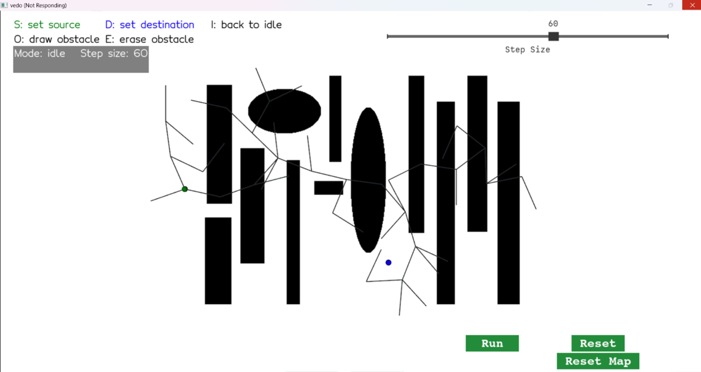
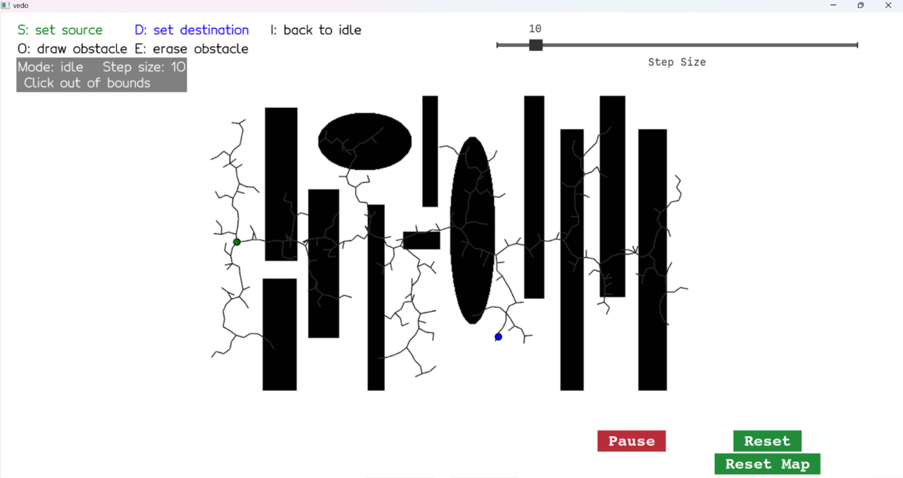

# Report for Assignment 4 - Path Planning with RRT

**Name:** Hala Ishan  
**Student ID:** 213692296
---
**Task 1: Complete the GUI**

### Task 1.1  
Add the ability to set the source and destination points. Add a button to reset the tree. Add a slider to change the step size.

| Requirement                               | Implementation                                                                                 |
|-------------------------------------------|-----------------------------------------------------------------------------------------------|
| Set source & destination points           | Press **S** (green) or **D** (blue), then click free map tiles; invalid clicks show warnings  |
| Reset tree button                         | Clears all RRT nodes & edges but preserves current start/goal markers                         |
| Step‐size slider (1–100)                  | Slider snaps to nearest integer; updates `stepSize` and status box live                       |
| Run/Pause toggle                          | Debounced (0.1 s) start/stop of the timer driving RRT iterations                              |

  
*Figure 1: Interactive GUI with key hints, status box, slider, Run/Pause & Reset buttons.   -    i changed the source and destination point then run it *  


## Task 1.2  
**Add a way to change the obstacle map**  
_Inspired by simple “paint” tools, we built a freehand brush for drawing and erasing obstacles in the RRT map._

| Requirement                       | Implementation                                                                                 |
|-----------------------------------|-----------------------------------------------------------------------------------------------|
| Freehand draw / erase             | **O** toggles draw mode (black brush), **E** toggles erase mode (white brush); move mouse to paint a 5×5 block under the cursor |
| No click-and-drag                 | Brush paints continuously on **mouse move**—just toggle on, sweep over the map, then toggle off |
| Endpoint validation               | Exiting draw mode automatically checks start/dest: if either lies on a newly drawn obstacle, the status box shows “⚠️ Source/Destination on obstacle – press S/D to move” |
| Reset map                         | **Reset Map** button restores the original image and clears all drawn obstacles              |

### Demonstration

[▶ Draw & Erase Obstacles](videos/draw.mkv)  
*Prior to recording, I toggled erase mode and cleared part of an original obstacle, then placed the destination point in that spot—verifying erase functionality. The clip then switches to draw mode to freehand paint new obstacles onto the map.*


 [▶ Reset Map](videos/reset.mkv)  
*The reset video shows restoring the map to its original state. After reset, if the start or destination now lies on an obstacle, the status box warns you to press S/D and move the point.*


## Task 1.3  
**Add other means to change the visualization as you see fit**  
i want to do it after i finished task 2 


## Task 2: Implement RRT

### 2.1 Complete `getNextSample`

The `getNextSample` function was verified to place every new node exactly `stepSize` units from its parent by:

- Sampling a point uniformly in the free space  
- Finding its nearest existing tree node  
- Computing the unit direction from that node toward the sample  
- Stepping exactly `stepSize` along that direction  


#### 2.2 Implement the Collision function

- **stepSize = 60**  
  


- **stepSize = 10**  
  

> **Note:** Obstacles are not yet considered; collision checking will be added in **Task 2.2**.  


### Task 2.2 Implement Collision Checking

To determine whether a straight‐line segment between two nodes intersects any obstacles, we:

1. **Enumerate all integer pixels** along the line using Bresenham’s algorithm.  
2. **Convert** each world‐coordinate `(x, y)` (origin at bottom‐left) into image indices `(row, col)` where `row = height - 1 - y`.  
3. **Probe** the obstacle map `img[row, col]` (where `True` = free, `False` = obstacle).  
4. **Return `True`** as soon as any pixel is in an obstacle; otherwise return `False` after checking the entire segment.

```python
def bresenham(x1, y1, x2, y2):
    dx, dy = abs(x2 - x1), abs(y2 - y1)
    x, y = x1, y1
    sx = 1 if x2 > x1 else -1
    sy = 1 if y2 > y1 else -1

    if dx > dy:
        err = dx / 2
        while x != x2:
            yield x, y
            err -= dy
            if err < 0:
                y += sy
                err += dx
            x += sx
        yield x, y
    else:
        err = dy / 2
        while y != y2:
            yield x, y
            err -= dx
            if err < 0:
                x += sx
                err += dy
            y += sy
        yield x, y

def Collision(img, p1, p2):
    """
    Return True if the line segment from p1 to p2 crosses any obstacle.
    - img : 2D boolean array (True=free, False=obstacle), origin at top-left.
    - p1, p2 : (x, y) world coords, origin at bottom-left.
    """
    h, w = img.shape
    for wx, wy in bresenham(p1[0], p1[1], p2[0], p2[1]):
        row = h - 1 - wy
        col = wx
        # out-of-bounds → treat as collision
        if row < 0 or row >= h or col < 0 or col >= w:
            return True
        if not img[row, col]:
            return True
    return False
````


**Explain the code:**

1. **Bresenham’s line generator**  
   - `bresenham(x1, y1, x2, y2)` implements the classic integer‐only algorithm to enumerate every grid cell (pixel) that a straight line from `(x1,y1)` to `(x2,y2)` passes through.  
   - It chooses to step in the dominant direction (x or y) and maintains an error accumulator to know when to step in the other axis.  

2. **World→Image coordinate conversion**  
   - Our RRT points use a “world” origin at the bottom‐left, but the NumPy image array `img` is indexed with row 0 at the top.  
   - Therefore we compute  
     ```python
     row = (height – 1) – world_y  
     col = world_x
     ```  
   - This flips the y-axis so we index the correct pixel in `img[row, col]`.

3. **Collision test loop**  
   ```python
   for wx, wy in bresenham(...):
       …
       if not img[row, col]:
           return True
   return False

* We iterate each pixel on the line.
* If **any** pixel is an obstacle (`img[row, col] == False`), we immediately return `True` (collision detected).
* If the loop completes with no obstacles, we return `False` (the path is clear).

4. **Out-of-bounds as collision**

   * We also treat any pixel outside the valid image bounds as a collision to be safe (e.g. if a sample drifts just off the map).

---

#### Sanity Check on the Full Map

The following screenshots show the RRT growing with collision checking enabled. In both cases the tree **never** penetrates the black obstacles:

- **stepSize = 10**  
    
  *Figure X: The tree explores up to each obstacle boundary but does not cross it.*

- **stepSize = 15**  
    
  *Figure Y: Even with a larger step, no edge crosses the original or newly drawn obstacles, and the tree can grow into areas where I erased obstacles.*  

These confirm that `Collision(img, parent, sample)` correctly rejects any extension into occupied space.
 
---

### Task 2.3 Add Stopping Conditions

I enhance `doRRTIteration` with two guards:  

1. **Max‐Iteration Guard**  
   Prevents infinite looping if the goal is unreachable.  
2. **Goal‐Reached Check**  
   Stops as soon as a new node can connect directly to the goal.

```python
def doRRTIteration(event):
    global iteration_count, timer_id

    # 1) Max‐iteration guard
    iteration_count += 1
    if iteration_count > MAX_ITERATIONS:
        update_status("❌ Max iterations reached, no path found")
        plt.timer_callback("destroy", timer_id)
        # return button to "Run" state if needed
        if button.status().strip() == "Pause":
            button.switch()
        return

    # … [sampling, collision‐check, drawing] …

    # 2) Goal‐reached check
    dist_to_goal = np.linalg.norm(ns.x - dest)
    if dist_to_goal <= stepSize and not Collision(img, ns.x, dest):
        # draw final connection
        final_edge = vd.Line(ns.x, dest, lw=3).c('red')
        edges.append(final_edge)
        plt.add(final_edge); plt.render()

        update_status("✅ Goal reached!")
        plt.timer_callback("destroy", timer_id)
        if button.status().strip() == "Pause":
            button.switch()
        return
```

**Reasoning:**

* **Max‐Iteration Guard:** Stops after a fixed number of iterations (`MAX_ITERATIONS = 3,000`) to avoid an endless loop when no path exists.
* **Goal‐Reached Check:**

  * Each new edge moves exactly `stepSize`.
  * Once a node lies within `stepSize` of the goal and the final segment to the goal is obstacle‐free, we know the path is found.
  * We draw the last red edge, halt further iterations, and reset the button for a clear UI state.

---

### Task 2.4 Experiment: RRT Execution Until Goal

I conducted numerous experiments with various `stepSize` values and iteration budgets; in every case the stopping conditions behaved correctly. Below are two representative trials, shown in the order they occur during a typical run:

---

#### Trial 1 — Goal Reached  
With `stepSize = 10` and `MAX_ITERATIONS = 3000`, the tree eventually grew close enough to the goal. A final red edge marks the successful connection, and the status box updates accordingly.


*Figure 4.1: “✅ Goal reached!” confirms the RRT found a collision-free path and drew the last segment in red.*

---

#### Trial 2 — Iteration Cap Reached  
In a separate run (or by continuing past the first trial), after 3000 iterations the tree still hadn’t connected to the destination. The timer stopped automatically and the status box displayed a warning. At this point you may choose to reset the tree/map and try again, or simply increase the iteration limit.


*Figure 4.2: “❌ Max iterations (3000) reached, no path found…” shows the RRT giving up after exhausting its iteration budget. You can continue running another 3000 iterations or reset and try different parameters.*

---

**Summary:**  
- The **Goal-Reached Check** halts and highlights the final edge as soon as a valid connection to the goal is found.  
- The **Max-Iteration Guard** prevents infinite looping when the goal is unreachable within the budget, and offers the option to continue or reset.  

---